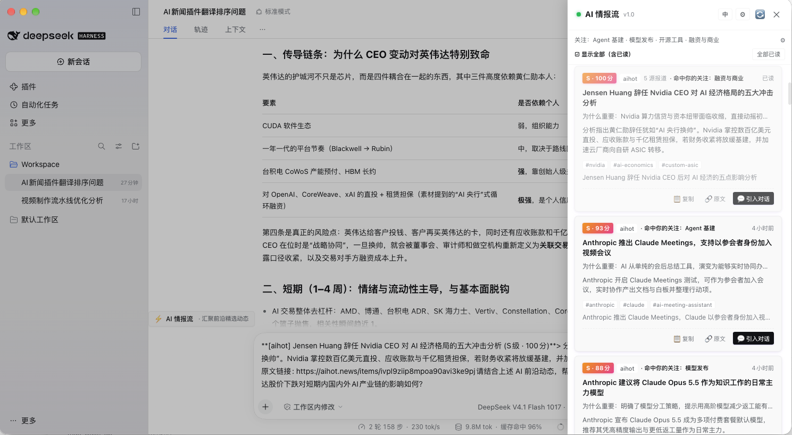

# ai-news-feed

> **What it is**: An all-in-one native AI intelligence & news feed plugin for DeepSeek Harness (DSH), with zero external Python or background process dependencies.  
> **What it gives you**: Configurable multi-source automated fetching + 5-axis LLM quantitative evaluation + realtime sidebar drawer + automated in-session morning and evening briefings.  
> **How to install**: `dsh plugin --profile desktop add "file:<source-path>"`.  
> **Version**: v1.0.0 · MIT · no external process dependencies



## 🌟 Key Features

- ⚡ **Six Native Sources**: Hacker News, GitHub Releases, AIHot Daily, OpenAI Blog, Google DeepMind, Simon Willison. You can customize the configuration of information sources that support RSS/ATOM subscriptions according to your needs.
- 🎯 **Five-Axis Scoring**: `industry/rubric.md` as single source of truth with SHA256 version hash; scoring and copywriting strictly separated; source weights and first-report penalties applied post-hoc in code and never passed into prompts.
- 📰 **Two-Layer Reading Surface**: L1 "Today's Must-Reads" = same-day, unread, clustered events at or above 80 (hard cap 5); L2 "Raw Stream" = every ingested signal, expanded by default, with Smart / Latest / Score sorting.
- 💬 **One-Click Conversation Import**: Use the "Import Conversation" button to load information directly into the chat box, then enter prompts for further analysis to gain deeper insights and assessments.
- 🔗 **Cross-Source Clustering**: same-day coverage of the same event is merged and badged with "N sources", while distinct model suffixes stay apart (`Gemini 4 Hydrogen` ≠ `Gemini 4 Carbon`).
- 🎛️ **Topic Personalization**: Agent Infra / Model Releases / Open-source Tools / Funding & Business, with only the first two enabled by default. Selected topics are injected into the scoring system prompt for up to +5 boost, which never leaks into the S-Tier flag — selecting all four cancels the effect.
- 🌏 **Bilingual Titles**: both Chinese and English sources carry `title_zh` / `title_en`; UI copy and titles follow the language setting. Summaries are generated once in the active language rather than duplicated.
- 🛡️ **Cost Guardrail + Zero-LLM Mode**: `dailyModelCallBudget` defaults to 120 calls/day, halting scoring at the cap and falling back to a plain list, reset at local midnight. Without an LLM the drawer still shows a weighted raw stream instead of a blank panel.
- 📬 **In-Session Briefings**: morning 08:00 and evening 20:00 digests injected into the original session via `@deepseek-ai/dsh-schedule`; cards can inject summary, score and link into the composer in one click.

---

## 🚀 Quick Start

### 1. Requirements

- **DSH** with the `@deepseek-ai/dsh-llm` service (any current desktop build).
- **Node.js 22+** and **pnpm** for building from source.
- A model selected in the DSH session (for scoring). Without one the plugin still runs in raw-stream mode.

The build toolchain is `typescript` + `react`/`react-dom` types + `tsx` for tests; `pnpm install` sets all of it up — nothing else to install manually.

### 2. Installation

> **Note**: This package is **not published to npm** — it is installed from a source checkout only. Registry installs such as `dsh plugin add ai-news-feed` **do not apply**; use one of the methods below.

#### Method A: Install from the source directory (recommended)

```bash
git clone https://github.com/laowang5/ai-news-feed.git
cd ai-news-feed
pnpm install
pnpm build

# Install this directory as a local package into the desktop profile
dsh plugin --profile desktop add "file:$(pwd)"
```

`dsh plugin add "file:<path>"` does three things automatically: writes the package into the profile `dependencies`, appends it to `dsh.profile.bundles`, and copies the build output into `node_modules` via pnpm. The plugin then **hot-loads** — no application restart required.

> 💡 Already have a local clone? Just run `dsh plugin --profile desktop add "file:<existing checkout>"` — no need to download another copy.
>
> 💡 To pick up code changes you must `pnpm build` and `add` again (pnpm skips the reinstall when the version number is unchanged, so `remove` before `add` when swapping build output).

#### Method B: Mount manually in the profile

If you prefer not to use the CLI, edit the profile's `cordis.patch.yml` (**not** `cordis.yml`):

```yaml
# ~/.dsh/profiles/desktop/cordis.patch.yml
- id: ai-news-feed
  name: "ai-news-feed"
  config:
    syncIntervalMinutes: 60
    firstSyncDelaySeconds: 5
    dailyModelCallBudget: 120
```

> ⚠️ Common mistake: `cordis.yml` is a generated, read-only merge result whose own header says "edit cordis.patch.yml, not this file". Adding a plugin there has no effect. Also, the patch file's top level is a **YAML array** (`- id:` / `- insert:`), not a `plugins:` mapping.
>
> A manual mount only writes the patch; the package still has to exist in `node_modules` (the `name` must resolve to a real directory) or the host will fail to load it. So prefer Method A unless you have already installed once that way.

#### ✅ No restart needed

Current DSH hot-loads plugins through the **bundle patch**: after install or upgrade the host re-reads the patch and mounts the service, so the sidebar entry is available immediately. Refresh the page to pick up a new build — you do not need to quit the app.

Only if your host version genuinely lacks hot-loading (older builds) should you consider a full restart.

**Self-check:**

```bash
# 1. Is the plugin registered? (expect state: live)
curl http://127.0.0.1:12333/dsh-market/installed

# 2. The plugin's own health endpoint
curl http://127.0.0.1:12333/dsh-plugins/ai-news-feed/health
```

In `health`, pay attention to three fields:

| Field | Meaning |
|---|---|
| `llm_state` | `available` fine / `missing` no usable model / `misconfigured` a model exists but calls are failing |
| `llm_backend` | `host-stream` uses the host LLM (zero config) / `fetch` uses a custom API / `none` |
| `llm_last_error` | The concrete error when `misconfigured` — tells you which model name or provider is wrong |

---

## ⚙️ Configuration Options

All options can be customized in `PluginConfig`:

| Option | Type | Default | Description |
|---|---|---|---|
| `syncIntervalMinutes` | `number` | `60` | Background sync interval in minutes. Set to `0` to disable auto-sync. |
| `firstSyncDelaySeconds` | `number` | `5` | Initial sync delay in seconds on host startup, ensuring content is available within 5 seconds. Set to `0` to disable. |
| `dailyModelCallBudget` | `number` | `120` | Daily limit on model calls (scoring + copywriting). Resets at local midnight. |
| `maxScoresPerRun` | `number` | `10` | Maximum pending items evaluated with LLM per sync cycle. |
| `scoreCalls` | `number` | `2` | Number of serial scoring samples per item (takes floored mean for stability). |
| `thresholds` | `object` | See below | 3-tier score thresholds. |
| `featuredMaxItems` | `number` | `20` | Candidate cap for the featured stream. **Today's Must-Reads is hard-capped at 5** (`Math.min(5, value)`), so larger values have no effect. |
| `appearance` | `'auto' \| 'light' \| 'dark'` | `'auto'` | Drawer palette; defaults to following the host's light/dark theme. |
| `display.language` | `'auto' \| 'zh' \| 'en'` | `'auto'` | UI language. `auto` follows the system locale and also determines the language of summaries and "why it matters". |
| `display.topics` | `string[]` | `['agent-infra','model-release']` | Focus topics; affects the score boost and the angle of "why it matters". |
| `fetchArticle.enabled` | `boolean` | `true` | Fetch the article body before scoring (5s timeout + 1 retry); items under 400 characters are skipped as `insufficient_content`. |
| `storePath` | `string` | `<dataDir>/signals.json` | Path to persistent JSON store. |

### LLM configuration (`llm*`)

**Zero config by default**: as long as a default model is selected in the DSH session, the plugin inherits it automatically via the host's `agentDefaultModel` service. None of the options below are needed unless you want to **pin a different model** (say, a cheaper small model dedicated to scoring).

| Option | Type | Default | Purpose |
|---|---|---|---|
| `llmModel` | `string` | inherits the session default | Model name used for scoring, e.g. `deepseek-chat`. Setting it overrides only the model; the provider is still resolved from the host. |
| `llmProvider` | `string` | auto-resolved | Provider that owns the model, e.g. `deepseek` / `openai`. Use it to disambiguate when the same model name exists under several providers. |
| `llmBaseUrl` | `string` | none | Fill in to call an **external OpenAI-compatible HTTP endpoint**, e.g. `http://127.0.0.1:3425/v1`. Together with `llmApiKey` this bypasses the host LLM. |
| `llmApiKey` | `string` | none | Bearer token used with `llmBaseUrl`. **Only takes effect when both `llmBaseUrl` and `llmApiKey` are set**; a key alone does nothing and the plugin stays on the host model. |
| `llmTimeoutMs` | `number` | `60000` | Per-call timeout in milliseconds. Raise it for slow models or long summaries. |

> **Three backends (`health.llm_backend`)**: `host-stream` = the host LLM service (default, zero config); `fetch` = direct call to `llmBaseUrl`; `none` = neither is usable, so the plugin degrades to "raw stream" mode where every item is labelled "⏳ Unscored" while fetching, sorting and reading still work normally.
>
> If `llmModel` or `llmProvider` is wrong, `health.llm_state` becomes `misconfigured`, a red banner appears at the top of the drawer with the concrete error, and items are tagged `skip_reason: score_failed: <reason>` — instead of silently sitting in `pending` forever as older builds did.

### Default Thresholds (`thresholds`)

```yaml
thresholds:
  featuredMinScore: 80   # Entry threshold for featured sidebar stream (covers ~45% of authoritative items)
  sTierScore: 85         # S-Tier badge cutoff (top ~20%)
  browseMinScore: 60     # Noise cutoff, below which no copywriting is generated
```

> The three thresholds serve **different surfaces**, not three filter tiers: `featuredMinScore` is the only product gate for Today's Must-Reads; `sTierScore` only drives the `S-Tier` badge; `browseMinScore` filters the raw stream and doubles as the exemption line for digest child events.

---

## 📡 Source Management (`sources.yaml`)

On startup, `sources.yaml` is automatically created in your project data directory (default `<project-dir>/data/sources.yaml` or system config directory). You can edit it directly to enable/disable or add custom RSS/Atom feeds:

```yaml
sources:
  # Hacker News AI stories (Algolia API, no key required)
  - id: hn
    type: api
    enabled: true
    keywords: [AI, LLM, Agent]
    windowHours: 48
    maxItemsPerRun: 20

  # GitHub Releases (public REST API, no key required)
  - id: github
    type: api
    enabled: true
    repos:
      - deepseek-ai/DeepSeek-V3
      - vllm-project/vllm
      - huggingface/transformers
      - anthropics/anthropic-sdk-python
    maxItemsPerRun: 15

  # AIHot Daily (Chinese, human-curated)
  - id: aihot
    type: rss
    enabled: true
    tier: tier_a          # curated by humans, ranks above discussion threads
    url: https://aihot.news/feed/daily.xml
    maxItemsPerRun: 2     # one item = one full day of digest; today + yesterday only

  # OpenAI Official News
  - id: rss-openai
    type: rss
    enabled: true
    url: https://openai.com/news/rss.xml
    maxItemsPerRun: 20

  # Google DeepMind Research & News
  - id: rss-deepmind
    type: rss
    enabled: true
    url: https://deepmind.google/blog/rss.xml
    maxItemsPerRun: 20

  # Simon Willison's Weblog (Atom)
  - id: rss-simonw
    type: atom
    enabled: true
    url: https://simonwillison.net/atom/everything/
    maxItemsPerRun: 20

  # Custom Industry RSS (Example)
  - id: my-custom-feed
    type: rss
    tier: tier_b
    enabled: true
    url: https://example.com/feed.xml
    maxItemsPerRun: 20
```

> Sources without a `tier` settle at `default` (×0.9). `tier` only affects the code-side multiplier and never enters the model prompt.

> **Source Tier Multipliers**: `tier_a` (×1.15), `tier_b` (×1.0), `tier_c` (×0.75), `default` (×0.9). Multipliers are applied strictly in code post-hoc and never passed into LLM prompts.

---

## 📰 Daily Intelligence Briefing (v1.0 Two-Layer Density)

### Today's Must-Reads (L1)
- Same-day (CST), unread, scored, unmerged events at or above `featuredMinScore` (default `80`) after cross-source clustering; **hard-capped at 5 items**, expanded when the drawer opens.
- **Digest child events are exempted from the 80-point line** and fall back to `browseMinScore` (60): AIHot is human-curated, so a single child event may not clear 80 on its own while the digest as a whole still deserves attention.
- Cards show an "N sources" badge, an `S-Tier` badge (`is_s_tier`, without topic boost), the matched focus topic, and a one-line "Why It Matters".
- **Opening the drawer does not mark anything as read**; clicking a title, expanding a summary, clicking "Inject into chat" or "Mark all read" writes the read state, and "Show all (including read)" switches back.

### Raw Stream (L2)
- **Expanded by default** — so an empty briefing never leaves a blank panel; shows every ingested signal, including unscored items and digest children.
- Supports the three local sorts (`Smart / Latest / Score`); the `⚙` in the header collapses it.

### Settings Panel
The `⚙` in the drawer header (or at the end of the topic summary row) expands in place:

| Item | Contents |
|---|---|
| Language | Follow system / 中文 / English, persisted to `preferences.json` |
| Focus topics | Four chips, multi-select; changes affect **future scoring only**, history is not rescored |
| Thresholds | 80 / 85 / 60 shown read-only (thresholds are a developer concern, not editable here) |

The header keeps a single summary line: `Following: Agent Infra · Model Releases ⚙`.

### How Topic Personalization Works
- Four built-in topics: `agent-infra`, `model-release`, `open-source`, `business`.
- **Only the first two are enabled by default; keep 2–3 — selecting all four dilutes the effect.**
- The boost is capped at +5 and never participates in the `is_s_tier` decision: an 82-point item cannot pass itself off as S-Tier through topic weight.

### Language & Bilingual Titles
- `title_zh` / `title_en` come from the same copywriting call: a Chinese source gets an English title and vice versa, **falling back to the original title when missing**.
- Summaries and "why it matters" are generated once in `display.language` and follow the language setting.
- Switching the language only changes which field is displayed; **it never rewrites historical items**. Entries missing that language keep falling back to what they have.

---

## 🤖 Registered Agent Tools

The plugin registers 7 powerful tools with the DSH host, which the Agent can invoke autonomously during conversations:

1. **`get_top_ai_news`**: Retrieve top AI signals with metadata (`stats.candidate_count`, `stats.pending_count`, `stats.budget_remaining_percent`).
2. **`search_ai_signals`**: Full-text search over local signal database by topic or keyword (e.g. `DeepSeek-V4.1`, `reasoning`).
3. **`trigger_feed_sync`**: Manually trigger background sync and scoring pipeline.
4. **`get_feed_health`**: Query source health status, error counters, and budget usage.
5. **`enable_briefing`**: Enable in-session morning (08:00:00) and evening (20:00:00) briefings.
6. **`disable_briefing`**: Disable briefings and clean up scheduled tasks to unblock session archiving.
7. **`get_briefing_prompt`**: Retrieve standard prompt template for morning or evening briefings.

---

## ❓ Frequently Asked Questions (FAQ)

### Q1: Can I use this plugin without configuring an LLM service?
**Yes, absolutely.** The plugin features Graceful Zero-LLM Degradation. If no LLM service or API key is available, the drawer defaults to the "Raw Stream" showing unscored signals sorted by source authority (e.g. OpenAI blog prioritised over generic feeds) and recency, ensuring new users never see a blank screen.

> In practice you almost certainly **do not need to configure anything**: the plugin inherits the model currently selected in the session. Manual `llmBaseUrl` + `llmApiKey` is only required when `health.llm_backend` is `none`.

### Q2: How is the daily 120 model call budget measured? What happens when it runs out?
- **Measurement**: Actual physical calls made to the LLM API. The scoring step consumes 2 calls per item (mean), and the copywriting step consumes 1 call. A 120-call budget supports in-depth evaluation of approximately **40 featured items per day**.
- **Exhaustion Guardrail**: Once 120 calls are reached for the day, evaluation is paused automatically. Newly ingested items remain in their raw `pending` state and are still viewable in the latest feed. No errors or surprise costs will occur. The budget automatically resets at local midnight.

### Q3: Why do briefings appear in chat sessions instead of desktop notifications?
DSH Desktop (0.2.2-rc.2) does not expose a desktop notification service, but provides a durable, persistent `@deepseek-ai/dsh-schedule` service. Having briefings in the chat session makes them durable, searchable, and lets you immediately follow up with questions (e.g. "Explain the technical implementation of item #2 in detail").

### Q4: What should I do if session archiving is blocked by active reminders?
For safety, the host rejects archiving sessions that still hold recurring reminders. Simply tell the assistant "Disable briefings in this session" or call the `disable_briefing` tool to unregister the reminders and archive the session.

### Q5: Why are source website names not visible in the scoring prompt?
This is an intentional anti-bias design. Passing "from OpenAI Blog" into the prompt tends to inflate scores based on reputation rather than technical substance. We strictly follow the "facts in input, weights post-hoc" principle: the LLM evaluates the event itself, and authority multipliers are applied in code.

### Q6: Is there any data leftover after uninstalling the plugin?
**Zero external scattering.** All runtime files (`signals.json`, `sources.yaml`, `budget.json`, `preferences.json`) are strictly contained inside `<dataDir>`. Uninstalling the plugin and restarting the host will leave no dangling references. To completely remove all data, simply delete the `data/` folder.

### Q7: I switched the language, but old items still show the other language. Why?
Copy is generated **at scoring time** in whatever `display.language` was active then, and it is frozen into the record. Switching the language only changes which field is displayed:

- Titles: when `title_en` / `title_zh` is missing, the card falls back to the original title — so old Chinese-source items keep their Chinese title in English mode.
- Summaries and "why it matters": there is only one copy, in the language used when it was scored.

The only way to change history is to rescore it, which is not worth the budget — **newly ingested items arrive with bilingual titles automatically.**

### Q8: Why aren't summaries bilingual like the titles?
Titles are **identifiers**: without the right language they are a wall — a Chinese title is unreadable to an English reader — so both versions must exist. Summaries are **interpretation**: writing two means outputting the same meaning twice in one call, roughly doubling output tokens, while a reader only ever sees one language at a time. The other copy would never be read.

So titles are bilingual; summaries and "why it matters" are generated once in `display.language`.

---

## 📄 License

Licensed under the [MIT License](LICENSE).
