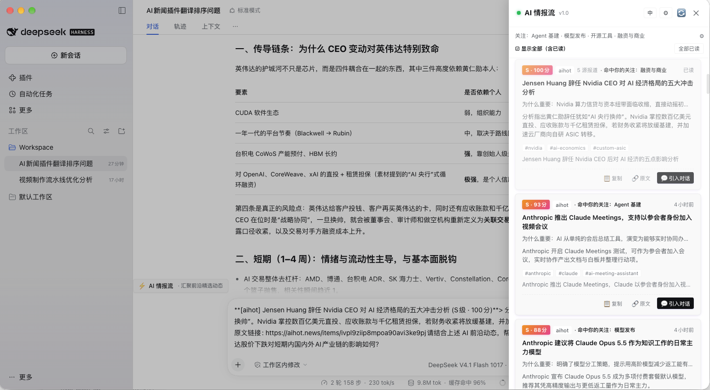

# @dsh-plugins/ai-news-feed

> **是什么**：DeepSeek Harness (DSH) 原生一体化的端到端 AI 前沿情报流插件，零外部 Python/进程依赖。  
> **给我什么**：可配置信源自动抓取 + 大模型五轴量化研判打分 + 侧栏实时抽屉阅读 + 每日会话内晨报/晚报主动推送。  
> **怎么装**：`dsh plugin add @dsh-plugins/ai-news-feed`（或在 `cordis.yml` 中配置启用）。  
> **版本**：v1.0.0 · MIT · 零外部进程依赖



## 🌟 核心特性

- ⚡ **六大原生信源**：Hacker News、GitHub Releases、AIHot 每日情报、OpenAI 官方博客、Google DeepMind、Simon Willison。可按需自定义配置支持RSS/ATOM订阅的信息源。
- 🎯 **五轴量化评分**：`industry/rubric.md` 单一事实源 + sha256 版本哈希，打分与精炼摘要严格分离；信源权重与首报惩罚全在代码后置结算、不传入 Prompt，模型无从被名气影响。
- 📰 **两层情报台**：L1「今日必看」= 自然日、未读、跨源合并后 ≥80 分的重大事件（硬上限 5 条）；L2「原始流」= 全量信号，默认展开，支持「智能 / 最新 / 分数」三态排序。
- 💬 **一键导入对话**：通过“导入对话”按钮直接将资讯导入到对话框中，输入需要进一步分析的提示，获取更多的研判信息。
- 🔗 **跨源事件合并**：同一天、同一事件的多源报道自动聚合，卡片显示「N 源报道」，并严格区分型号后缀（`Gemini 4 Hydrogen` ≠ `Gemini 4 Carbon`）。
- 🎛️ **关注方向个性化**：Agent 基建 / 模型发布 / 开源工具 / 融资与商业，默认只勾前两项。勾选项注入评分 system 段，最高 +5 加权且不污染 S 级判定——全选等于没选。
- 🌏 **中英双语标题**：中文源与英文源都同时具备 `title_zh` / `title_en`，界面文案与标题跟随语言设置切换；摘要按当前语言**单语**生成，不写两份译文。
- 🛡️ **成本护栏 + 零模型可用**：`dailyModelCallBudget` 默认 120 次/天，触顶自动停止评分并转纯列表展示，本地零点重置；没配模型也能用，展示按权重排序的原始流，不空白不崩溃。
- 📬 **会话内晨报 / 晚报**：借助宿主 `@deepseek-ai/dsh-schedule`，晨报 08:00、晚报 20:00 注入原会话，可直接对某条追问 Agent；卡片支持一键把摘要、评分与链接引入对话框。

---

## 🚀 快速上手

### 1. 开发环境要求

开发环境依赖项：

```
    "@types/node": "^22.10.0",

    "@types/react": "^19.0.0",

    "@types/react-dom": "^19.3.0",

    "esbuild": "^0.28.2",

    "react": "^19.0.0",

    "react-dom": "^19.3.1",

    "tsdown": "^0.6.0",

    "tsx": "^4.23.15",
```

### 2. 安装插件

#### 方式 A：通过 DSH CLI（推荐）
```bash
dsh plugin add @dsh-plugins/ai-news-feed
```

#### 方式 B：本地开发与源码安装
```bash
git clone https://github.com/laowang5/ai-news-feed.git
cd ai-news-feed
pnpm install
pnpm build
```

在你的 DSH 配置文件（如 `~/.dsh/profiles/desktop/cordis.yml`）中添加插件：
```yaml
plugins:
  "@dsh-plugins/ai-news-feed":
    # 可选自定义配置
    syncIntervalMinutes: 60
    dailyModelCallBudget: 120
```

#### ⚠️ 重要步骤：完全重启桌面端

**安装或升级插件后，必须完全退出 DeepSeek Harness 桌面应用（macOS 下按 `Cmd+Q`）并重新启动。** 仅通过快捷键刷新前端窗口无法生效，因为宿主的客户端启动清单（boot manifest）是在 DSH 主进程启动时生成的。

**用户自查验证（DevTools Console）：**
在 DSH 桌面端打开开发者工具（Console），执行以下命令：
```js
window.__DSH_BOOT__.entries.map(e => e.id)
```
输出列表中应包含 `'@dsh-plugins/ai-news-feed'`。若不包含，说明插件尚未在当前 profile 中正确注册或 DSH 进程尚未完全重启。

---

## ⚙️ 配置参数详解

所有配置项均可在 `PluginConfig` 中自定义：

| 参数名 | 类型 | 默认值 | 作用说明 |
|---|---|---|---|
| `syncIntervalMinutes` | `number` | `60` | 后台全源周期同步间隔（分钟）。设为 `0` 表示关闭后台定时同步。 |
| `firstSyncDelaySeconds` | `number` | `5` | 宿主启动后触发首次轻量同步的延迟（秒），保障新用户首装 5 秒内见内容。设为 `0` 则禁用首同步。 |
| `dailyModelCallBudget` | `number` | `120` | 每日模型调用次数上限（评分与摘要共用此计数器）。到顶后只抓取不打分。 |
| `maxScoresPerRun` | `number` | `10` | 每轮同步中最多使用大模型评分的待处理条目数。 |
| `scoreCalls` | `number` | `2` | 单条新闻的大模型评分采样次数（默认串行 2 次取向下取整均值，提升鲁棒性）。 |
| `thresholds` | `object` | 见下文 | 自定义三层门槛分级配置。 |
| `featuredMaxItems` | `number` | `20` | 精选流候选上限。**今日必看硬上限固定 5 条**（`Math.min(5, 配置值)`），调大无效。 |
| `appearance` | `'auto' \| 'light' \| 'dark'` | `'auto'` | 抽屉配色，默认跟随宿主浅/深色主题。 |
| `display.language` | `'auto' \| 'zh' \| 'en'` | `'auto'` | 界面与文案语言。`auto` 跟随系统 locale；同时决定摘要与「为什么重要」的生成语言。 |
| `display.topics` | `string[]` | `['agent-infra','model-release']` | 关注方向，影响评分加权与「为什么重要」的写作侧重。 |
| `fetchArticle.enabled` | `boolean` | `true` | 评分前抓取原文正文（5s 超时 + 1 次重试）；正文不足 400 字符的条目跳过模型调用并标记 `insufficient_content`。 |
| `storePath` | `string` | `<dataDir>/signals.json` | 信号持久化存储路径。 |

### 门槛配置默认值 (`thresholds`)

```yaml
thresholds:
  featuredMinScore: 80   # 决定首屏是否展示（实测覆盖约 45% 的权威动态）
  sTierScore: 85         # S 级高光徽标门槛（占总数前 20% 以内）
  browseMinScore: 60     # 浏览线，低于此分数的低质资讯将被过滤，不生成研判摘要
```

> 三个阈值**作用面不同**，不是三档筛选：`featuredMinScore` 是「今日必看」的唯一产品门槛；`sTierScore` 只决定卡片上的 `S 级` 徽标；`browseMinScore` 是原始流过滤线兼日报子事件豁免线。

---

## 📡 信源管理 (`sources.yaml`)

插件启动后会在数据目录（默认 `<project-dir>/data/sources.yaml` 或系统配置目录）自动生成配置文件。你可以直接编辑它来启用、禁用或新增 RSS/Atom 源：

```yaml
sources:
  # Hacker News 前沿动态（Algolia API，免 Key）
  - id: hn
    type: api
    enabled: true
    keywords: [AI, LLM, Agent]
    windowHours: 48
    maxItemsPerRun: 20

  # GitHub 重点仓库版本发布（公开 REST API，免 Key）
  - id: github
    type: api
    enabled: true
    repos:
      - deepseek-ai/DeepSeek-V3
      - vllm-project/vllm
      - huggingface/transformers
      - anthropics/anthropic-sdk-python
    maxItemsPerRun: 15

  # AIHot 每日情报（中文，人工策展）
  - id: aihot
    type: rss
    enabled: true
    tier: tier_a          # 人工策展，评分优先级高于讨论帖
    url: https://aihot.news/feed/daily.xml
    maxItemsPerRun: 2     # 一个 item = 一整天日报，只取当天 + 前一天

  # OpenAI 官方技术动态
  - id: rss-openai
    type: rss
    enabled: true
    url: https://openai.com/news/rss.xml
    maxItemsPerRun: 20

  # Google DeepMind 研究与新闻
  - id: rss-deepmind
    type: rss
    enabled: true
    url: https://deepmind.google/blog/rss.xml
    maxItemsPerRun: 20

  # Simon Willison 的博客（Atom）
  - id: rss-simonw
    type: atom
    enabled: true
    url: https://simonwillison.net/atom/everything/
    maxItemsPerRun: 20

  # 自定义行业 RSS（示例）
  - id: my-custom-feed
    type: rss
    tier: tier_b
    enabled: true
    url: https://example.com/feed.xml
    maxItemsPerRun: 20
```

> 未写 `tier` 的源按 `default`（×0.9）结算。`tier` 只影响代码层的权重乘数，不会进入模型 Prompt。

> **信源分级系数**：`tier_a` (×1.15)、`tier_b` (×1.0)、`tier_c` (×0.75)、`default` (×0.9)。信源权重完全在代码层后置结算，绝不传入大模型 Prompt。

---

## 📰 每日情报台（v1.0 两层信息密度）

### 今日必看（L1）
- 当日（CST）+ 未读 + 已评分 + 未被合并，跨源聚合后达到 `featuredMinScore`（默认 80）的重大事件；**硬上限 5 条**，打开抽屉默认展开。
- **日报拆条子事件豁免 80 分线**，下探至 `browseMinScore`（60）：AIHot 是人工策展，单条子事件未必够 80，整份日报仍然值得看。
- 卡片额外呈现「N 源报道」计数、`S 级` 高光徽标（`is_s_tier`，不含主题加权）、命中关注方向徽标，以及单行「为什么重要」。
- **打开抽屉不会自动标记已读**；点击标题、展开摘要、点「引入对话」或顶部「全部已读」才写已读，可用「显示全部（含已读）」切回。

### 原始流（L2）
- **默认展开**——今日必看为空时也不会看到空面板；呈现全量入库信号（含未评分条目与日报拆出的子条目）。
- 支持「智能 / 最新 / 分数」三态本地排序；顶部 `⚙` 可把它收起。

### 设置面板
抽屉右上角 `⚙`（或主题摘要行末尾的 `⚙`）就地展开，三项：

| 项 | 内容 |
|---|---|
| 语言 | 跟随系统 / 中文 / English，持久化到 `preferences.json` |
| 关注方向 | 4 个 chip 多选，改动只影响**后续评分**，不重算历史条目 |
| 门槛 | 80 / 85 / 60 只读展示（阈值是开发者工作，不开放编辑） |

主界面顶部只留一行摘要：`关注：Agent 基建 · 模型发布 ⚙`。

### 主题个性化怎么起作用
- 内置 4 个方向：`agent-infra`（Agent 基建）、`model-release`（模型发布）、`open-source`（开源工具）、`business`（融资与商业）。
- **默认只勾前两项，建议保持 2-3 个——全选会稀释个性化效果。**
- 加权上限 +5，且不参与 `is_s_tier` 判定：82 分的条目不会靠加权冒充 S 级。

### 语言与双语标题
- `title_zh` / `title_en` 由同一次文案调用产出：原文是中文就给英文标题，原文是英文就给中文标题，**缺失时回落原文标题**。
- 摘要与「为什么重要」按 `display.language` 生成一份，随语言设置显示。
- 切换语言只改变「显示哪一版」，**不会重写历史条目的文案**：老条目缺的那份语言按原样回落。

---

## 🤖 原生 Agent 工具

插件向 DSH 宿主注册了 7 个强大的工具函数，Agent 可在对话中自主调用：

1. **`get_top_ai_news`**：获取近期高分精选 AI 资讯，附带当前候选总数、未评分数与预算使用率元数据。
2. **`search_ai_signals`**：根据关键词（如 `DeepSeek-V4.1`, `reasoning`）全文检索本地情报知识库。
3. **`trigger_feed_sync`**：手动触发信源异步抓取与大模型评分流水线。
4. **`get_feed_health`**：查询各信源健康状态、成功率、最后抓取时间及模型预算消耗。
5. **`enable_briefing`**：为当前会话开启定时晨报（默认 08:00:00）与晚报（默认 20:00:00）。
6. **`disable_briefing`**：关闭当前会话的定时简报任务，清理计划任务以解锁会话归档。
7. **`get_briefing_prompt`**：获取标准的晨报与晚报生成 Prompt 模板。

---

## ❓ 常见问题 (FAQ)

### Q1: 如果我没有配置大模型服务，插件还能正常工作吗？
**能，完全可用。** 插件具备 Graceful Zero-LLM Degradation（零模型平稳可用）机制。若宿主未注入 LLM 且未提供 API Key，侧栏会自动展示「原始流」，条目标注「⏳ 未评分」，并根据信源权重（如 OpenAI 博客优先于普通流）与发布时间综合排序，保证新装用户绝不面对空白页面。

### Q2: 每日 120 次模型调用预算是如何计量的？用完了会怎样？
- **计量口径**：实际调用 LLM 的物理次数。打分阶段单条消耗 2 次调用（取均值），摘要阶段消耗 1 次调用。120 次预算约可支持每天研判 **40 条精选深度情报**。
- **触顶保护**：当日达到 120 次后，插件会自动暂停大模型打分，后续抓取的新闻保持 `pending` 原始状态入库展示，不会报错，也不会意外产生超额账单。每天本地零点自动重置。

### Q3: 为什么晨报/晚报不弹桌面通知，而是出现在聊天会话里？
DSH 桌面宿主（0.2.2-rc.2）未暴露系统的桌面通知 API，但挂载了强一致、可持久化的计划任务内核 `@deepseek-ai/dsh-schedule`。更重要的是，**简报出现在会话中才是最有价值的交互**：
1. 它是真实可读、可截图、可沉淀在上下文中的资产；
2. 你可以直接在对话框里对 Agent 追问：“展开说说第 2 条技术的实现方案”，瞬间进入深度探讨。

### Q4: 归档会话时提示有活跃任务（Active Reminders），该怎么办？
宿主出于安全保护机制，会拒绝归档名下带有未完成循环提醒任务的会话。你只需在对话框中对助手说“关闭当前会话的早晚报”或调用 `disable_briefing` 工具，即可一键注销定时任务并顺利归档会话。

### Q5: 为什么评分 Prompt 里看不到文章的来源网站名称？
这是出于严格的防偏见与防欺骗设计。如果将“来自 OpenAI 官方博客”传入模型，模型打分极易受到名气影响而产生通胀。我们严格遵循“输入只给事实，权重后置结算”原则，大模型只看事件本质，信源倍率在代码层计算。

### Q6: 卸载插件后会有数据残留吗？
**零外部散落。** 插件产生的所有运行时数据（`signals.json`、`sources.yaml`、`budget.json`、`preferences.json`）均严格收拢在 `<dataDir>` 目录中，卸载插件后重启宿主不会触发任何异常引用。如需彻底删除数据，直接移除 `data/` 目录即可。

### Q7: 切换语言后，为什么老条目的标题和摘要没变？
文案是在**评分那一刻**按当时的 `display.language` 生成的，写完就固化在数据里。切语言只决定「显示哪一版字段」，不会重写历史条目：

- 标题：`title_en` / `title_zh` 缺失时回落原文标题，所以中文源的老条目在英文模式下仍显示中文标题。
- 摘要与「为什么重要」：只有一份，语言由评分时的设置决定。

想彻底解决只能重新评分，而预算不该花在这上面——**新抓取的条目会自动带上双语标题**。

### Q8: 为什么摘要不像标题那样出双语？
标题是**标识**，缺了就没法读——中文标题对英文用户等于一堵墙，所以必须两个语言都有。摘要是**解读**，写两份等于同一次调用把同样的意思输出两遍，输出 token 接近翻倍，而读者任何时刻只看一种语言，多出来的那份永远不会被看到。

所以只有标题走双语，摘要与「为什么重要」按 `display.language` 生成一份。


---

## 📄 开源许可证

本项目采用 [MIT 许可证](LICENSE)。
